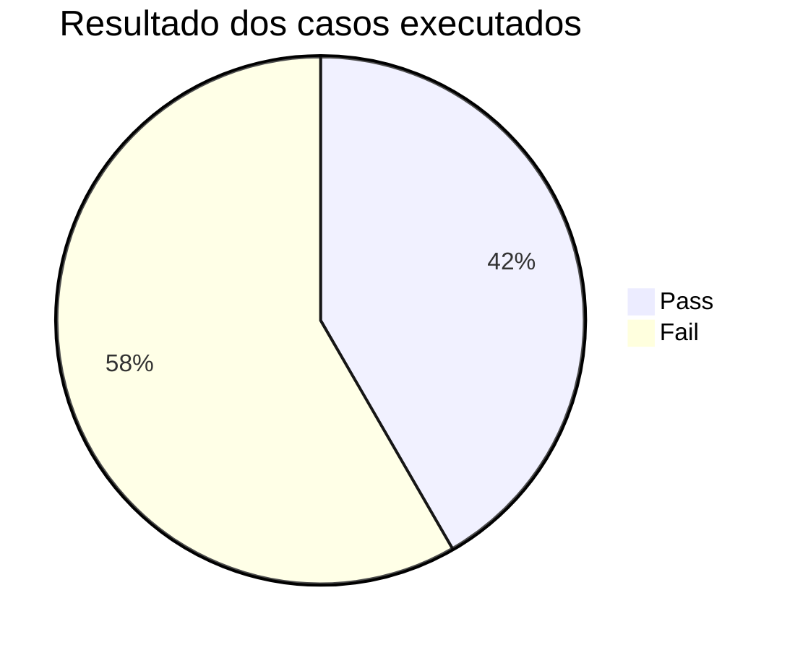
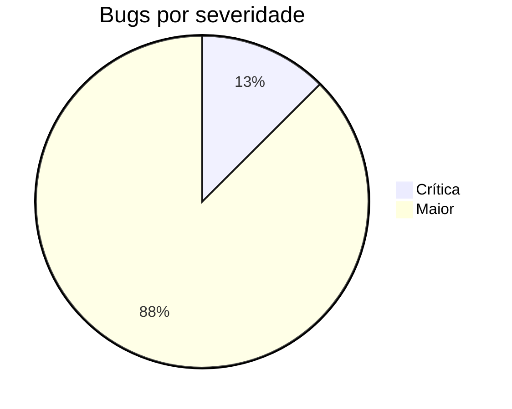

# Relatório de Testes: NaSalinha

**Responsável:** João Pedro Ribeiro Santiago · **Versão testada:** commit 8ce1fac do NaSalinha

## 1. Recomendação

**O NaSalinha não está pronto para produção.** As três áreas Core têm falhas em regras centrais:

- qualquer membro lê check-ins de outras pessoas (falha de controle de acesso);
- o cadastro não verifica a conta;
- a moderação do admin não tem efeito nos pontos, então o ranking aceita e mantém pontos que não deveriam existir.

PEDIDO AO TIME: Antes de lançar, é preciso corrigir pelo menos o BUG-CHK-01, o BUG-PTS-01 e o BUG-PTS-02, e depois rodar a regressão descrita em [regressao.md](regressao.md).

## 2. Escopo

- **Dentro:** Autenticação JWT, Check-in por foto, Pontos e ranking.
- **Tipos:** funcional (pela interface), API (Postman) e regressão (simulada, um cenário por área).
- **Abordagem:** caixa-cinza. Além da tela e da API, conferimos o banco (psql), o container (pasta `uploads/`) e o código para a análise de cada bug.
- **Fora:** desempenho, segurança além do controle de acesso, acessibilidade e compatibilidade entre navegadores.
- **Ambiente:** Windows + WSL Ubuntu · Docker Compose (PostgreSQL 15, backend Node, frontend React) · Chrome · Postman Desktop · Mailtrap (sandbox) · Cloudinary · banco com o seed padrão.

## 3. Métricas de execução

| Área             | Planejados | Executados | Pass   | Fail   | Não executados |
| ---------------- | ---------- | ---------- | ------ | ------ | -------------- |
| Autenticação     | 8          | 8          | 5      | 3      | 0              |
| Check-in         | 10         | 9          | 3      | 6      | 1              |
| Pontos e ranking | 7          | 6          | 2      | 4      | 1              |
| Ad-hoc           | 1          | 1          | 0      | 1      | 0              |
| **Total**        | **26**     | **24**     | **10** | **14** | **2**          |

**Cobertura de execução:** 24 ÷ 26 = **92%** · **Taxa de aprovação:** 10 ÷ 24 = **42%**

Os 3 casos de regressão (CT-JWT-REG-01, CT-CHK-REG-01, CT-PTS-REG-01) são cenários simulados, descritos em [regressao.md](regressao.md). Por isso não entram na conta de Pass e Fail.

A suíte de API no Postman (Runner, coleção `NaSalinha QA`) registrou:

- 01 Autenticação: 31 asserções, 28 Pass e 3 Fail;
- 02 Check-in: 17 asserções, 12 Pass e 5 Fail;
- 03 Pontos e ranking: 25 asserções, 22 Pass e 3 Fail.

A matriz completa está em [casos-de-teste.md](casos-de-teste.md).

## 4. Distribuição de severidade

| Severidade | Definição                                  | Quantidade | Bugs                                                                               |
| ---------- | ------------------------------------------ | ---------- | ---------------------------------------------------------------------------------- |
| Crítica    | Trava o sistema ou anula uma regra central | 1          | BUG-CHK-01                                                                         |
| Maior      | Erro de lógica                             | 7          | BUG-JWT-01, BUG-JWT-02, BUG-CHK-02, BUG-CHK-03, BUG-PTS-01, BUG-PTS-02, BUG-PTS-03 |
| Menor      | Erro visual ou de texto                    | 0          | —                                                                                  |

**Bugs por área:** Autenticação 2 · Check-in 3 · Pontos e ranking 3 (incluindo 1 ad-hoc). Todos os bugs estão nas [issues com a label bug](../../../issues?q=label%3Abug).

## 5. Principais riscos

1. **BUG-CHK-01 (Crítica):** qualquer membro logado abre check-ins de outros usuários pelo ID, vendo foto, nome e e-mail (`GET /api/checkins/:id` devolve 200).
2. **BUG-PTS-01 (Maior):** excluir um check-in não desconta os pontos. A consulta de divergência mostrou o Lucas com 30 pontos guardados contra 20 reais.
3. **BUG-PTS-02 (Maior):** check-ins nascem APPROVED e somam pontos na hora, e rejeitar um check-in não tira os pontos. A moderação do admin não tem efeito no ranking.

## 6. Regressão

Foi descrito um cenário por área em [regressao.md](regressao.md), sempre com reteste, vizinhança e fluxo principal:

- Autenticação: correção do BUG-JWT-01;
- Check-in: correção do BUG-CHK-01;
- Pontos: correção do BUG-PTS-01.

A suíte de API pode ser reexecutada pelo terminal com o Newman (comando em [regressao.md](regressao.md)). Como não houve nova versão do NaSalinha, o reteste dos bugs não pôde confirmar correções.

## 7. Limitações e premissas

- **"Mesma foto" (RF-04):** foi interpretada como o mesmo arquivo enviado de novo (real.jpg duas vezes).
- **RF-01:** foi interpretado como exigindo conta PENDENTE, código por e-mail e tela para digitar o código. Nenhum dos três existe.
- **CT-PTS-API-14:** não foi executado porque depende de envios em horários controlados (23h50 e 0h10). O comportamento relacionado, de aceitar mais de um check-in no mesmo dia, foi visto no CT-CHK-API-13.
- **CT-CHK-API-19:** não foi executado.
- **CT-CHK-API-20:** exigiu alterar `CLOUDINARY_API_SECRET` em `backend/.env` e recriar o container. Uma primeira tentativa, sem a alteração aplicada, foi descartada.
- **Ordem da coleção:** a coleção do Postman depende da ordem e do estado do banco. Tokens expiram e o seed recria os IDs, por isso a pasta `00 Setup` precisa rodar de novo antes de cada bloco.
